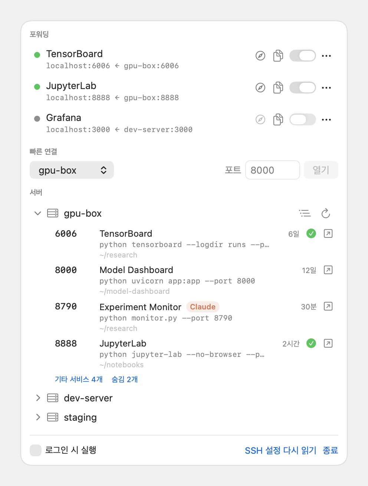
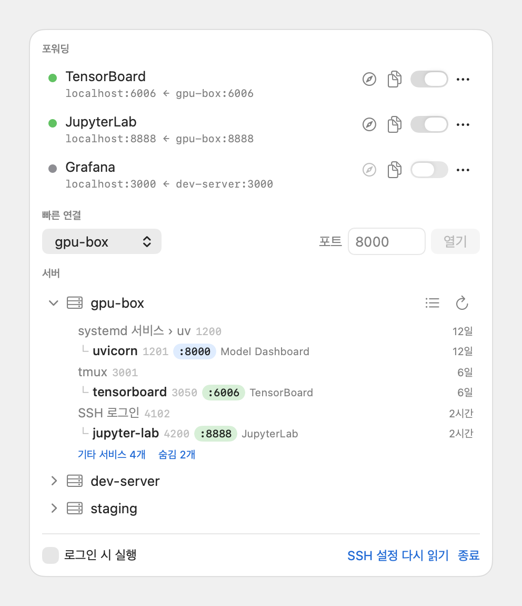
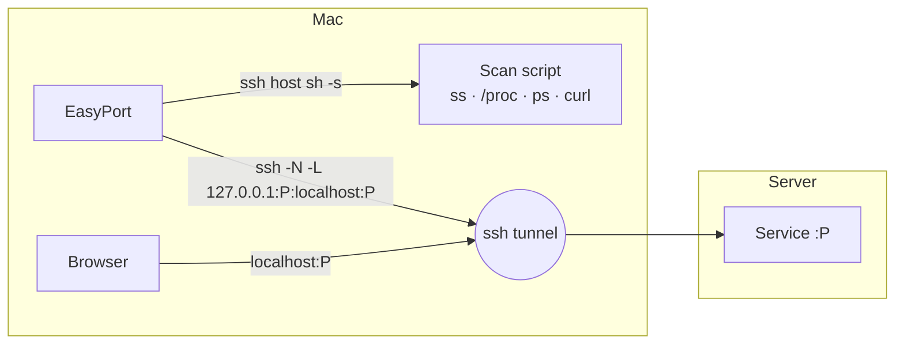

<div align="center">

# EasyPort

**A macOS menu bar app that forwards ports from SSH servers and opens them in your browser**

<p>
  
  
  
  
</p>

[한국어](README.md) · **English**

</div>

---

## Why

- When I work with Claude Code on a GPU server, Claude starts web pages inside the server. Connecting them to a local port on my Mac every time is tedious.
- Solving it on the server side means exposing a port, and I don't want to worry about the security of that.
- I know a port is open somewhere, but asking Claude again which one it was is also tedious.

EasyPort connects from the Mac over SSH, so it opens web pages running inside the server without exposing any new port on the server. Expand a server to see its listening ports and the processes behind them. Click a port to forward it to `localhost` and open it in the browser.

> [!NOTE]
> The app's interface is currently in Korean only.

## Features

<div align="center">

<table>
  <tr>
    <td align="center"><b>List view</b></td>
    <td align="center"><b>Process tree view</b></td>
  </tr>
  <tr>
    <td>
      <picture>
        <source media="(prefers-color-scheme: dark)" srcset="docs/screenshot-list-dark.png">
        
      </picture>
    </td>
    <td>
      <picture>
        <source media="(prefers-color-scheme: dark)" srcset="docs/screenshot-tree-dark.png">
        
      </picture>
    </td>
  </tr>
</table>

</div>

### Port discovery
- **Server list**: Reads `Host` aliases from `~/.ssh/config`, following `Include` directives.
- **Listening ports**: Expanding a server shows its listening TCP ports with the process name, command line, working directory, and uptime.
- **Web page detection**: Sends an HTTP request from inside the server, only to ports owned by your own processes, to check whether the port serves HTML. The page `<title>` is used as the name, so a port shows up as `TensorBoard` instead of `python`.
- **Claude Code badge**: Processes started by Claude Code get a `Claude` badge, detected from the `CLAUDECODE=1` environment variable of the process. You no longer need to ask Claude which port it opened.
- **Automatic grouping**: Ports are sorted into three groups.

  | Group | Condition | Default |
  |---|---|---|
  | Web pages | Your process and responds with HTML, or a port you have forwarded before | Expanded |
  | Other services | Your process and responds with a non-HTML API or does not respond | Collapsed |
  | Hidden | Other users' processes, VS Code server, Claude Code, ssh tunnels, system ports below 1024 | Collapsed |

  Right-click a port to set `Always show` or `Hide`.

### Process tree
- Follows the parents of each listening process up to just below PID 1 and shows them as a hierarchy.
- Skips sshd and shell steps and summarizes the launch path in one line, for example `SSH login › claude › uv`, `systemd service › uv`, or `tmux`.
- Processes whose working directory has been deleted (for example, a server started from a removed git worktree) are shown in orange.

### Forwarding
- **One click**: Clicking a port forwards it with `ssh -L` and opens the browser once the tunnel is up.
- **Quick connect**: Pick a server and type a port number to open it.
- **Status**: Connected, connecting, error, or off. Errors show the ssh error message as is.
- **Reconnect**: When ssh drops, EasyPort reconnects with a delay starting at 2 seconds, up to 30 seconds. It also reconnects after the Mac wakes from sleep.
- **Restore**: Forwards that are switched on are restored when the app starts again.
- **Local port selection**: Uses the same number as the remote port, or the next free number if it is taken.

### Stopping remote processes
- Right-click a listening process to stop it. EasyPort sends SIGTERM, and if the process has not exited within 3 seconds, it asks whether to send SIGKILL.
- Right before sending the signal, it checks on the server that the process name and start time of that PID still match the scan. If the PID has been reused by another process in the meantime, nothing is stopped.

## Installation

Requires macOS 14 or later. Paste this line into Terminal to download the latest release, install it to `~/Applications`, and launch it.

```sh
curl -fsSL https://raw.githubusercontent.com/JuwonHwang/easyport/main/install.sh | bash
```

Running the same command again updates to the latest version. The app is a universal binary for both Apple Silicon and Intel Macs.

Servers must use key-based authentication. EasyPort runs ssh with `BatchMode=yes`, so it never prompts for a password. If `ssh <host>` connects without a password in Terminal, it will connect in EasyPort too.

<details>
<summary>Build from source</summary>

Requires the Xcode Command Line Tools (`xcode-select --install`). The Xcode app is not needed.

```sh
git clone https://github.com/JuwonHwang/easyport.git
cd easyport
./build.sh install    # install to ~/Applications/EasyPort.app and launch
```

`./build.sh` alone builds `build/EasyPort.app` without installing it.

</details>

> [!NOTE]
> The first time EasyPort connects to a server on a private IP (such as `192.168.x.x`), macOS asks for permission to access the local network. If you denied it, turn on EasyPort in System Settings > Privacy & Security > Local Network.

## How it works



- **Scan**: Runs `ssh <host> sh -s` once per server and sends the scan script over standard input. Nothing is installed on the server. The script is in [`RemoteScript.swift`](Sources/EasyPort/RemoteScript.swift).
- **Forwarding**: Each forward runs one `/usr/bin/ssh -N -L 127.0.0.1:<local>:<target>:<remote>` process. It binds only to `127.0.0.1`, so other devices on the same network cannot reach it.
- **Cleanup**: When the app quits, it stops only the ssh processes EasyPort started for forwarding. ssh sessions you opened yourself in Terminal or VS Code are left alone. If the app was force-quit and its ssh processes were left behind, they are cleaned up on the next launch. Only ssh processes whose parent is PID 1 and whose command line matches EasyPort's exact arguments are affected.

## Stored data

| File | Contents |
|---|---|
| `~/Library/Application Support/EasyPort/forwards.json` | Forward list and on/off state |
| `~/Library/Application Support/EasyPort/ports.json` | Manual grouping, ports you have forwarded before |

## Development

```sh
swift build                                     # debug build
.build/debug/EasyPort --snapshot /tmp/shots     # scan real servers and save the panel as PNG
.build/debug/EasyPort --snapshot docs --demo    # generate README screenshots from demo data
```

`--snapshot` renders the panel in light and dark mode and exits without starting any forward. It is used to check the layout.

Pushing a tag that starts with `v` makes GitHub Actions build the universal app and upload it to the Release as `EasyPort.zip`. Locally, `VERSION=0.1.0 ./build.sh release` produces the same zip.

| File | Role |
|---|---|
| `EasyPortApp.swift` | Menu bar app entry point, termination signal handling |
| `ForwardManager.swift` | Forward state, ssh process management, port grouping, remote stop |
| `PortScanner.swift` | Scan result parsing, process tree construction |
| `RemoteScript.swift` | sh scripts that run on the server |
| `SSHConfig.swift` | `~/.ssh/config` parsing |
| `LocalPort.swift` | Local port availability checks |
| `PanelView.swift` | Panel UI |
| `Snapshot.swift` | Snapshot rendering, demo data |

## License

[MIT](LICENSE) © JuwonHwang
