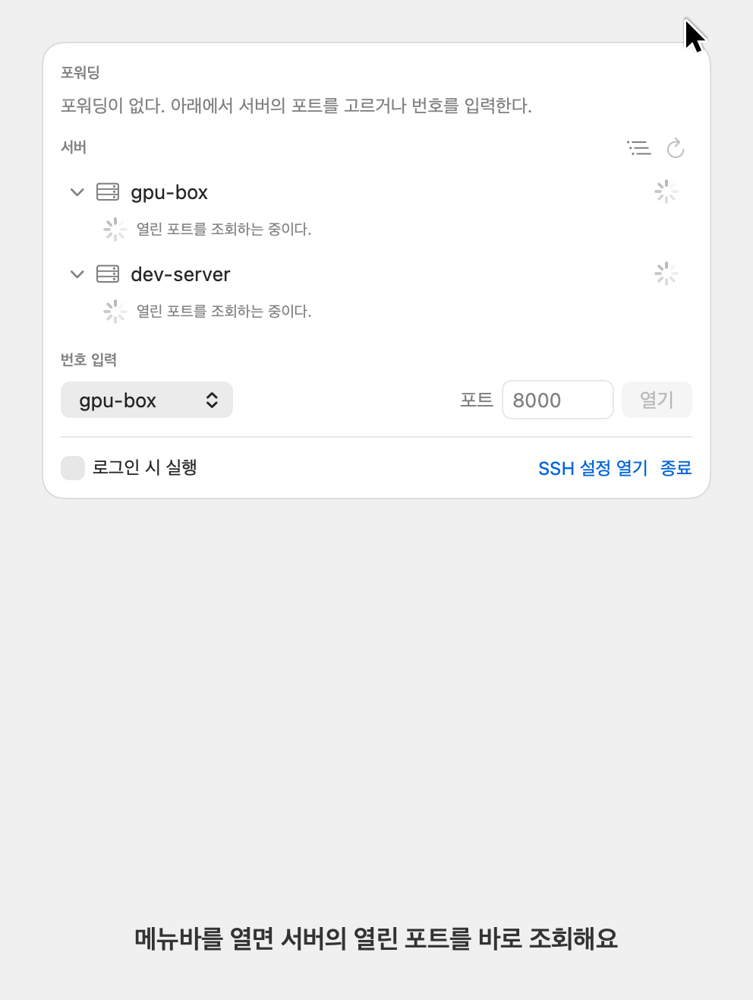
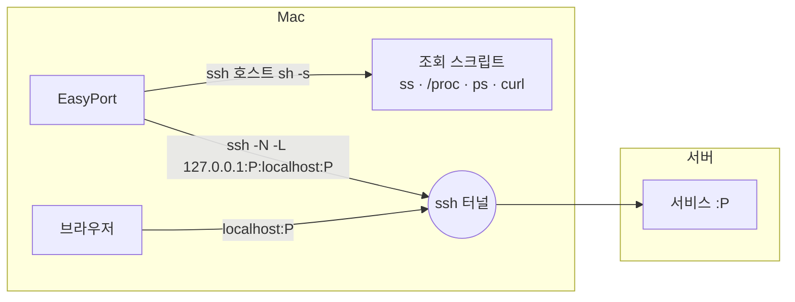

<div align="center">

# EasyPort

**SSH 서버의 포트를 메뉴바에서 포워딩하고 브라우저로 여는 macOS 앱**

<p>
  
  
  
  
</p>

**한국어** · [English](README.en.md)

</div>

---

## 만든 이유

- GPU 서버에서 Claude Code로 작업하면 Claude가 서버 안에서 웹 페이지를 띄워요. 그걸 내 맥의 로컬 포트로 연결하는 일이 번거로워요.
- 서버 쪽에서 해결하려면 포트를 외부에 열어야 하는데, 보안이 신경 쓰여요.
- 열어 둔 포트가 분명히 있는데, 그 번호를 Claude에게 다시 물어보는 것도 번거로워요.

EasyPort는 맥에서 SSH로 연결해서, 서버에 포트를 새로 열지 않고 서버 안의 웹 페이지를 바로 열어요. 서버를 펼치면 열린 포트와 그 포트를 띄운 프로세스가 보이고, 포트를 클릭하면 `localhost`로 포워딩한 뒤 브라우저에서 열어요.

## 기능

<p align="center">
  
</p>

- **포트 목록**: 서버를 펼치면 열린 포트를 페이지 제목, 명령줄, 작업 디렉터리, 실행 시간과 함께 보여 줘요. 서버 목록은 `~/.ssh/config`에서 읽어요.
- **Claude 표시**: Claude Code가 띄운 프로세스에 `Claude` 배지를 붙여요.
- **자동 분류**: HTML로 응답하는 내 포트만 펼쳐 보여 주고, API·내부 포트와 VS Code 같은 도구 포트는 접어 둬요. 우클릭으로 직접 고정하거나 숨길 수 있어요.
- **한 번 클릭**: 포트를 누르면 `ssh -L`로 포워딩하고 브라우저를 열어요. 끊기면 다시 연결하고, 앱을 다시 켜면 켜 둔 포워딩을 복원해요.
- **프로세스 트리**: 포트를 띄운 경로를 `SSH 로그인 › claude › uv`처럼 한 줄로 보여 줘요. 작업 디렉터리가 삭제된 프로세스는 주황색으로 표시해요.
- **원격 종료**: 우클릭으로 남은 프로세스를 종료해요. 종료 직전에 프로세스 이름과 시작 시각으로 같은 프로세스인지 다시 확인해요.

## 설치

macOS 14 이상에서 실행돼요. 터미널에 한 줄을 붙여 넣으면 최신 릴리스를 받아 `~/Applications`에 설치하고 실행해요.

```sh
curl -fsSL https://raw.githubusercontent.com/JuwonHwang/easyport/main/install.sh | bash
```

같은 명령을 다시 실행하면 최신 버전으로 업데이트돼요. 앱은 Apple Silicon과 Intel 맥 모두에서 실행되는 유니버설 바이너리예요.

서버 접속은 키 인증이어야 해요. EasyPort는 ssh를 `BatchMode=yes`로 실행해서 비밀번호를 묻지 않아요. 터미널에서 `ssh <호스트>`가 비밀번호 없이 접속되면 EasyPort에서도 접속돼요.

<details>
<summary>소스에서 빌드하기</summary>

Xcode Command Line Tools(`xcode-select --install`)가 필요해요. Xcode 앱은 필요 없어요.

```sh
git clone https://github.com/JuwonHwang/easyport.git
cd easyport
./build.sh install    # ~/Applications/EasyPort.app에 설치하고 실행
```

`./build.sh`만 실행하면 `build/EasyPort.app`을 만들고 설치는 하지 않아요.

</details>

> [!NOTE]
> 사설 IP(`192.168.x.x` 등)의 서버에 처음 접속할 때 macOS가 로컬 네트워크 접근 허용을 물어요. 거부했다면 시스템 설정 > 개인정보 보호 및 보안 > 로컬 네트워크에서 EasyPort를 켜 주세요.

## 동작 방식



- **조회**: 서버마다 `ssh <호스트> sh -s`를 한 번 실행하고, 조회 스크립트를 표준 입력으로 보내요. 서버에 아무것도 설치하지 않아요. 스크립트는 [`RemoteScript.swift`](Sources/EasyPort/RemoteScript.swift)에 있어요.
- **포워딩**: 포워딩마다 `/usr/bin/ssh -N -L 127.0.0.1:<로컬>:<대상>:<원격>` 프로세스를 하나 실행해요. `127.0.0.1`에만 bind하므로 같은 네트워크의 다른 기기는 접근할 수 없어요.
- **정리**: 앱이 종료되면 EasyPort가 포워딩용으로 띄운 ssh만 종료해요. 터미널이나 VS Code에서 직접 연결한 ssh는 건드리지 않아요. 앱이 강제 종료되어 EasyPort의 ssh가 남으면 다음 실행 때 정리하는데, 부모가 PID 1이고 명령줄이 EasyPort의 인자 조합과 일치하는 ssh만 대상으로 해요.

## 저장 위치

| 파일 | 내용 |
|---|---|
| `~/Library/Application Support/EasyPort/forwards.json` | 포워딩 목록과 켜짐 여부 |
| `~/Library/Application Support/EasyPort/ports.json` | 직접 지정한 분류, 포워딩한 적이 있는 포트 |

## 개발

```sh
swift build                                     # 디버그 빌드
.build/debug/EasyPort --snapshot /tmp/shots     # 실제 서버를 조회해 패널을 PNG로 저장
.build/debug/EasyPort --snapshot docs --demo    # 가상 데이터로 스크린샷 생성
```

`--snapshot`은 포워딩을 시작하지 않고 패널을 라이트, 다크 모드로 렌더링한 뒤 종료해요. 레이아웃 점검에 써요.

릴리스는 `v`로 시작하는 태그를 올리면 GitHub Actions가 유니버설 앱을 빌드해 Release에 `EasyPort.zip`으로 올려요. 로컬에서는 `VERSION=0.1.0 ./build.sh release`로 같은 zip을 만들 수 있어요.

| 파일 | 역할 |
|---|---|
| `EasyPortApp.swift` | 메뉴바 앱 진입점, 종료 신호 처리 |
| `ForwardManager.swift` | 포워딩 상태, ssh 프로세스 관리, 포트 분류, 원격 종료 |
| `PortScanner.swift` | 조회 결과 파싱, 프로세스 트리 구성 |
| `RemoteScript.swift` | 서버에서 실행하는 sh 스크립트 |
| `SSHConfig.swift` | `~/.ssh/config` 파싱 |
| `LocalPort.swift` | 로컬 포트 사용 여부 확인 |
| `PanelView.swift` | 패널 UI |
| `Snapshot.swift` | 스냅샷 렌더링, 데모 데이터 |

## 라이선스

[MIT](LICENSE) © JuwonHwang
