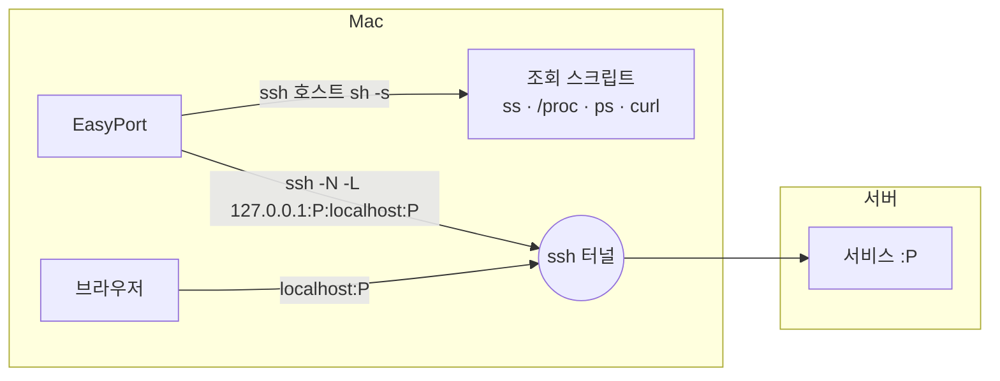

<div align="center">

# EasyPort

**SSH 서버의 포트를 메뉴바에서 포워딩하고 브라우저로 여는 macOS 앱**

<p>
  
  
  
  
</p>

</div>

---

## 만든 이유

- 서버의 로컬 포트에 띄워 둔 사이트나 그 포트 번호를 자주 잊어요.
- 서버에 어떤 포트가 열려 있는지 모니터링하는 일이 번거로워요.

EasyPort는 이 두 가지를 위해 만들었어요. 서버를 펼치면 열린 포트와 그 포트를 띄운 프로세스가 보이고, 포트를 클릭하면 `localhost`로 포워딩한 뒤 브라우저에서 열어요.

## 기능

<div align="center">

<table>
  <tr>
    <td align="center"><b>목록 보기</b></td>
    <td align="center"><b>프로세스 트리 보기</b></td>
  </tr>
  <tr>
    <td>
      <picture>
        <source media="(prefers-color-scheme: dark)" srcset="docs/screenshot-list-dark.png">
        
      </picture>
    </td>
    <td>
      <picture>
        <source media="(prefers-color-scheme: dark)" srcset="docs/screenshot-tree-dark.png">
        
      </picture>
    </td>
  </tr>
</table>

</div>

### 포트 탐색
- **서버 목록**: `~/.ssh/config`의 `Host` 별칭을 읽어요. `Include`도 따라가요.
- **열린 포트 조회**: 서버를 펼치면 대기 중인 TCP 포트와 프로세스 이름, 명령줄, 작업 디렉터리, 실행 시간을 보여 줘요.
- **웹 페이지 판별**: 서버 안에서 각 포트에 HTTP 요청을 보내 HTML로 응답하는지 확인하고, 페이지 `<title>`을 이름으로 써요. `python` 대신 `TensorBoard`로 표시돼요.
- **Claude Code 표시**: Claude Code가 띄운 프로세스에 `Claude` 표시를 붙여요. 프로세스의 환경 변수 `CLAUDECODE=1`로 판별해요. Claude에게 어떤 포트를 열었는지 다시 묻지 않아도 돼요.
- **자동 분류**: 포트를 세 묶음으로 나눠요.

  | 분류 | 조건 | 기본 표시 |
  |---|---|---|
  | 웹 페이지 | 내 프로세스이고 HTML 응답, 또는 포워딩한 적이 있는 포트 | 펼침 |
  | 기타 서비스 | 내 프로세스이고 API 응답이나 응답 없음 | 접힘 |
  | 숨김 | 다른 사용자의 프로세스, VS Code 서버, Claude Code, ssh 터널, 1024 미만 시스템 포트 | 접힘 |

  우클릭으로 `항상 표시`, `숨기기`를 지정할 수 있어요.

### 프로세스 트리
- 포트를 연 프로세스의 부모를 PID 1 직전까지 따라가 계층으로 보여 줘요.
- sshd, 셸 단계는 생략하고 실행 경로를 한 줄로 요약해요. 예: `SSH 로그인 › claude › uv`, `systemd 서비스 › uv`, `tmux`.
- 작업 디렉터리가 삭제된 프로세스(지운 git worktree에서 실행된 서버 등)를 주황색으로 표시해요.

### 포워딩
- **한 번 클릭**: 포트를 클릭하면 `ssh -L`로 포워딩하고, 연결되면 브라우저를 열어요.
- **빠른 연결**: 서버를 고르고 포트 번호를 입력해 열어요.
- **상태 표시**: 연결됨, 연결 중, 오류, 꺼짐. 오류는 ssh의 오류 문장을 그대로 보여 줘요.
- **재연결**: ssh가 끊기면 2초부터 최대 30초 간격으로 재연결해요. 잠자기에서 깨어나면 다시 연결해요.
- **복원**: 켜 둔 포워딩은 앱을 다시 실행하면 복원돼요.
- **로컬 포트 선택**: 원격 포트와 같은 번호를 쓰고, 사용 중이면 다음 빈 번호를 써요.

### 원격 프로세스 종료
- 포트를 연 프로세스를 우클릭해 종료해요. SIGTERM을 보내고, 3초 안에 종료되지 않으면 SIGKILL을 보낼지 다시 물어요.
- 신호를 보내기 직전에 서버에서 그 PID의 프로세스 이름이 조회 때와 같은지 확인해요.

## 설치

macOS 14 이상에서 실행돼요. 터미널에 한 줄을 붙여 넣으면 최신 릴리스를 받아 `~/Applications`에 설치하고 실행해요.

```sh
curl -fsSL https://raw.githubusercontent.com/JuwonHwang/easyport/main/install.sh | bash
```

같은 명령을 다시 실행하면 최신 버전으로 업데이트돼요. 앱은 Apple Silicon과 Intel 맥 모두에서 실행되는 유니버설 바이너리예요.

서버 접속은 키 인증이어야 해요. EasyPort는 ssh를 `BatchMode=yes`로 실행해서 비밀번호를 묻지 않아요. 터미널에서 `ssh <호스트>`가 비밀번호 없이 접속되면 EasyPort에서도 접속돼요.

<details>
<summary>소스에서 빌드하기</summary>

Xcode Command Line Tools(`xcode-select --install`)가 필요해요. Xcode 앱은 필요 없어요.

```sh
git clone https://github.com/JuwonHwang/easyport.git
cd easyport
./build.sh install    # ~/Applications/EasyPort.app에 설치하고 실행
```

`./build.sh`만 실행하면 `build/EasyPort.app`을 만들고 설치는 하지 않아요.

</details>

> [!NOTE]
> 사설 IP(`192.168.x.x` 등)의 서버에 처음 접속할 때 macOS가 로컬 네트워크 접근 허용을 물어요. 거부했다면 시스템 설정 > 개인정보 보호 및 보안 > 로컬 네트워크에서 EasyPort를 켜 주세요.

## 동작 방식



- **조회**: 서버마다 `ssh <호스트> sh -s`를 한 번 실행하고, 조회 스크립트를 표준 입력으로 보내요. 서버에 아무것도 설치하지 않아요. 스크립트는 [`RemoteScript.swift`](Sources/EasyPort/RemoteScript.swift)에 있어요.
- **포워딩**: 포워딩마다 `/usr/bin/ssh -N -L 127.0.0.1:<로컬>:<대상>:<원격>` 프로세스를 하나 실행해요. `127.0.0.1`에만 bind하므로 같은 네트워크의 다른 기기는 접근할 수 없어요.
- **정리**: 앱이 종료되면 EasyPort가 포워딩용으로 띄운 ssh만 종료해요. 터미널이나 VS Code에서 직접 연결한 ssh는 건드리지 않아요. 앱이 강제 종료되어 EasyPort의 ssh가 남으면 다음 실행 때 정리하는데, 부모가 PID 1이고 명령줄이 EasyPort의 인자 조합과 일치하는 ssh만 대상으로 해요.

## 저장 위치

| 파일 | 내용 |
|---|---|
| `~/Library/Application Support/EasyPort/forwards.json` | 포워딩 목록과 켜짐 여부 |
| `~/Library/Application Support/EasyPort/ports.json` | 직접 지정한 분류, 포워딩한 적이 있는 포트 |

## 개발

```sh
swift build                                     # 디버그 빌드
.build/debug/EasyPort --snapshot /tmp/shots     # 실제 서버를 조회해 패널을 PNG로 저장
.build/debug/EasyPort --snapshot docs --demo    # 가상 데이터로 README 스크린샷 생성
```

`--snapshot`은 포워딩을 시작하지 않고 패널을 라이트, 다크 모드로 렌더링한 뒤 종료해요. 레이아웃 점검에 써요.

릴리스는 `v`로 시작하는 태그를 올리면 GitHub Actions가 유니버설 앱을 빌드해 Release에 `EasyPort.zip`으로 올려요. 로컬에서는 `VERSION=0.1.0 ./build.sh release`로 같은 zip을 만들 수 있어요.

| 파일 | 역할 |
|---|---|
| `EasyPortApp.swift` | 메뉴바 앱 진입점, 종료 신호 처리 |
| `ForwardManager.swift` | 포워딩 상태, ssh 프로세스 관리, 포트 분류, 원격 종료 |
| `PortScanner.swift` | 조회 결과 파싱, 프로세스 트리 구성 |
| `RemoteScript.swift` | 서버에서 실행하는 sh 스크립트 |
| `SSHConfig.swift` | `~/.ssh/config` 파싱 |
| `LocalPort.swift` | 로컬 포트 사용 여부 확인 |
| `PanelView.swift` | 패널 UI |
| `Snapshot.swift` | 스냅샷 렌더링, 데모 데이터 |

## 라이선스

[MIT](LICENSE) © JuwonHwang
